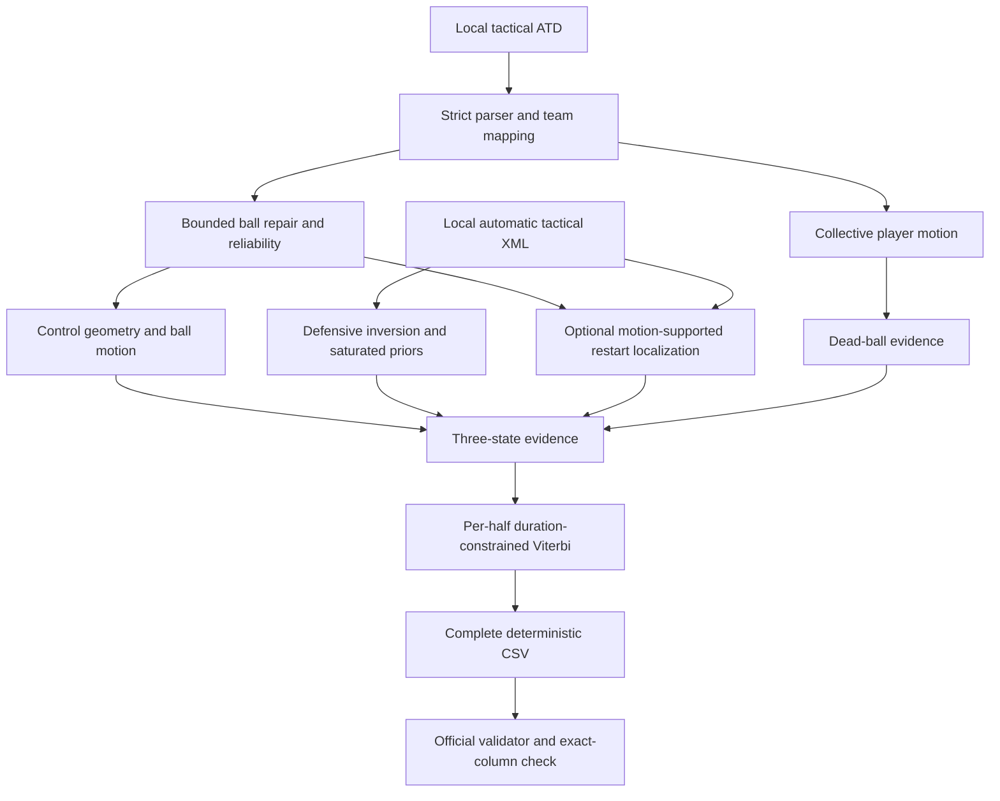

# Architecture

No ground-truth file is an input. No raw match data leaves local processing.
`data.py` parses; `preprocessing.py` repairs; `features.py`, `tagging.py` and
`restarts.py` build evidence; `temporal.py` solves the state sequence; `pipeline.py`
assembles them. The generation script writes LF UTF-8 CSV and hashes every used
input, code/config snapshot and output. No cache is reused for release verification.
